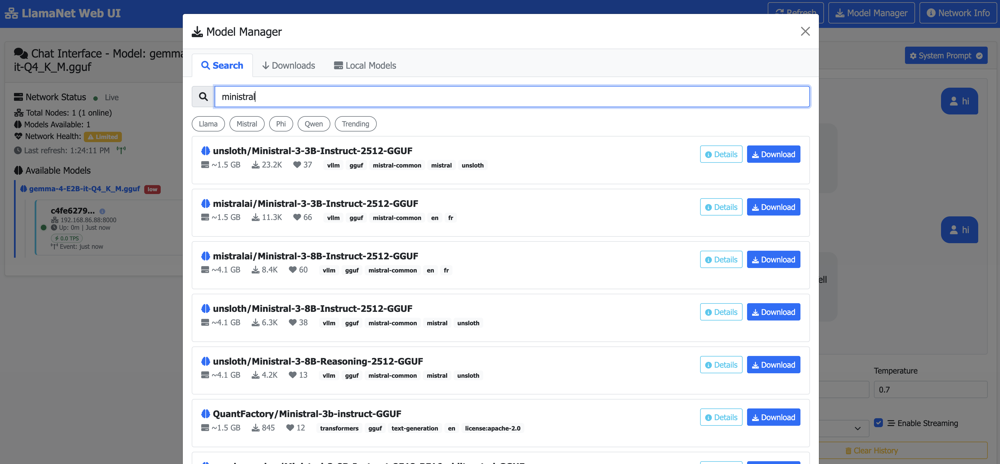

# LlamaNet - Free OpenAI-Compatible API from Your Mac/GPU | Local LLM GGUF Server


[](https://pypi.org/project/llamanet/)
[](https://llamanet.app)
[](LICENSE)
[](https://www.python.org/)
[](docs/deployment.md)

**Turn your idle Mac or GPU into a free public AI API. Local GGUF LLM server with OpenAI-compatible /v1/chat/completions, public HTTPS URL in 60s. Ollama alternative with sharing built-in.**

> Your Mac is idle 18 hours a day. Let it do something useful.

LlamaNet is a free, open-source local LLM inference server powered by llama.cpp. Run Mistral, Llama 3, Qwen, Phi, Gemma, DeepSeek-R1 GGUF models on Mac Apple Silicon, NVIDIA GPU, or CPU — then share via Cloudflare tunnel with zero config.

One command.
60 seconds.
Zero config.

Get a public URL.
Run your own models.
Let friends, apps, or AI agents use your machine.

```
curl -sSL https://llamanet.app/install.sh | sh
llamanet run hf.co/mlabonne/Meta-Llama-3.1-8B-Instruct-abliterated-GGUF:Q4_K_M
```

That's it. Your Mac is now an AI server.



## Documentation

| Guide | What's inside |
|---|---|
| [Quick Start](#quick-start) | Install, run, and call the API in under 2 minutes |
| [Models & Multi-Model Pool](docs/models.md) | Supported models, hardware tiers, pool with LRU eviction |
| [Computer-Use Agent](docs/agent.md) | Fara1.5-9B browser agent + REST/SSE API for custom apps |
| [Gateway & Enterprise Hosting](docs/gateway.md) | Architecture, run your own gateway, **internal hosting for teams** |
| [Deployment](docs/deployment.md) | macOS, Linux, Windows, cloud VPS, RunPod, vast.ai, Docker |
| [API Reference](docs/api-reference.md) | All endpoints, environment variables, rate limits |
| [FAQ](docs/faq.md) | Common questions |

## Contents

- [Why?](#why)
- [Quick Start](#quick-start)
- [How It Works](#how-it-works)
- [Features](#features)
- [Ollama vs LM Studio vs LlamaNet](#ollama-vs-lm-studio-vs-llamanet--best-local-llm-server--ollama-alternative)
- [Enterprise & Private Deployments](#enterprise--private-deployments)
- [Requirements](#requirements)
- [Built On](#built-on)

## Why?

- **Your hardware is underutilized.** Apple Silicon has a Neural Engine, 16-core GPU, and unified memory — and most of the time it's rendering Finder windows.
- **AI APIs are expensive.** GPT-4 costs $30/M tokens. You can run an equivalent model on your Mac for the cost of electricity.
- **Open-source models are good enough.** Mistral, Qwen, Llama, Gemma — they run locally, they're fast, and they're free.
- **Sharing is the hard part.** LlamaNet handles that: tunnels, routing, discovery, load balancing. You just run the model.

## Quick Start

### Install (One Command)

```bash
# macOS / Linux
curl -sSL https://llamanet.app/install.sh | sh

# Windows (PowerShell)
irm https://llamanet.app/install.ps1 | iex
```

The installer:
- Detects or installs Python 3.9+
- Creates an isolated venv at `~/.llamanet/venv`
- Installs LlamaNet and llama-cpp-python
- Creates a `llamanet` CLI launcher and Desktop shortcut
- Auto-joins the public network at **llamanet.app**

Then run:

```bash
llamanet
```

1. Open **http://localhost:8000** — the Model Manager opens automatically
2. Search for a GGUF model (e.g. `qwen`, `llama`, `mistral`)
3. Click **Download** — progress streams in real time
4. Click **Use** — the model hot-loads and your node joins the network

You can also pre-load a model at startup:

```bash
llamanet run hf.co/mlabonne/Meta-Llama-3.1-8B-Instruct-abliterated-GGUF:Q4_K_M
```

Or install via PyPI:

```bash
pip install llamanet
llamanet run hf.co/mlabonne/Meta-Llama-3.1-8B-Instruct-abliterated-GGUF:Q4_K_M
```

Models can be switched at any time via the Web UI without restarting the node. Full platform instructions (macOS, Linux, Windows, cloud) are in [docs/deployment.md](docs/deployment.md).

### Uninstall

```bash
# macOS / Linux
curl -sSL https://llamanet.app/uninstall.sh | sh

# Windows (PowerShell)
irm https://llamanet.app/uninstall.ps1 | iex
```

### API Consumer — Use the Network

```python
import openai

client = openai.OpenAI(
    base_url='https://llamanet.app/v1',
    api_key='your-api-key'
)

response = client.chat.completions.create(
    model='Meta-Llama-3.1-8B-Instruct',
    messages=[{'role': 'user', 'content': 'Hello!'}]
)

print(response.choices[0].message.content)
```

Get a free API key at [llamanet.app](https://llamanet.app).

## How It Works

```
You                                  Your friend
───                                  ───────────
llamanet run \                        client = openai.OpenAI(
  hf.co/user/Model:Q4_K_M             base_url="https://llamanet.app/v1",
                                       api_key="ln-xxx"
       │                             )
       ▼                                 │
┌─────────────────────────────────────────────┐
│           llamanet.app (Gateway)             │
│                                              │
│  Node Registry · Request Router · Auth       │
│  Real-time SSE · Model Discovery             │
└─────────────────────────────────────────────┘
```

1. **You** run the one-liner installer → `llamanet` → node auto-joins `llamanet.app`
2. You download a model via the Web UI Model Manager
3. Your node gets a Cloudflare tunnel URL (public, HTTPS) — **zero config**
4. **Anyone** calls `llamanet.app/v1/chat/completions` with an API key
5. Gateway routes to the best available node

No Docker. No Kubernetes. No port forwarding. Just a tunnel and a registry.

## Features

- **No-Model Mode** — Start your node instantly, download models later via the Web UI
- **Hot Reload** — Switch models without restarting your node — download, select, done
- **OpenAI-Compatible API** — Drop-in replacement for any OpenAI client
- **Free Public URLs** — Automatic Cloudflare tunnels, zero config
- **Web UI** — Built-in model manager, chat interface, and network dashboard at `localhost:8000`
- **Model Manager** — Search Hugging Face, download GGUF models with real-time progress, switch models without restarting
- **Model Discovery** — Search and connect to models across the network
- **Reasoning Support** — DeepSeek-R1, Qwen reasoning models with streaming reasoning content
- **Gateway Routing** — Central gateway with automatic node discovery and load balancing
- **Real-time Network** — SSE-powered live updates for node status, model availability, and metrics
- **GPU Auto-detect** — NVIDIA, Apple Silicon, CPU fallback
- **Computer-Use Agent** — Native harness for Fara1.5-9B browser automation with safety controls ([docs/agent.md](docs/agent.md))

## Ollama vs LM Studio vs LlamaNet - Best Local LLM Server & Ollama Alternative

| | Ollama | LM Studio | Jan / LocalAI / llama.cpp server | LlamaNet |
|---|---|---|---|---|
| Local GGUF inference | yes | yes | yes | yes |
| OpenAI-compatible API (`/v1/chat/completions`) | yes | yes | partial | yes |
| Public URL in 60s | no | no | no | yes - Cloudflare tunnel |
| Model manager in browser | no | yes | no | yes - search Hugging Face, download, hot-reload |
| Multi-model pool | no | no | no | yes - LRU, instant switch |
| Reasoning models (DeepSeek-R1, Qwen, GPT-OSS streaming) | partial | partial | partial | yes |
| Run on Mac Apple Silicon (Metal) | yes | yes | varies | yes - Metal auto-detect |

## Enterprise & Private Deployments

Running LlamaNet inside a company, team, or research lab? The gateway is a lightweight FastAPI service you can host internally — nodes and API consumers stay on your network, with your own auth, budgets, and quality gate.

See **[docs/gateway.md](docs/gateway.md)** for:
- One-afternoon internal gateway setup (Supabase + gateway + team rollout)
- Pointing team nodes at an internal gateway (`--bootstrap-peers https://your-gateway`)
- Per-key token budgets, concurrency limits, and the node quality gate
- Security and operations notes for private deployments

## Requirements

- Python 3.9+
- GGUF format models
- 4GB+ RAM (depends on model size)
- `cloudflared` (auto-installed by the installer and `start-app.sh` on macOS/Linux)
- [llama.cpp](https://github.com/ggml-org/llama.cpp) — C/C++ inference engine that powers all GGUF model execution via [llama-cpp-python](https://github.com/abetlen/llama-cpp-python)

## Built On

LlamaNet is built on top of these open-source projects:

- **[llama.cpp](https://github.com/ggml-org/llama.cpp)** — Fast LLM inference in C/C++ with Apple Metal, CUDA, and CPU support. The core engine that runs all GGUF models.
- **[llama-cpp-python](https://github.com/abetlen/llama-cpp-python)** — Python bindings for llama.cpp with OpenAI-compatible API support.
- **[FastAPI](https://fastapi.tiangolo.com/)** — High-performance Python web framework for the API server.
- **[Cloudflare Tunnels](https://developers.cloudflare.com/cloudflare-one/connections/connect-apps/)** — Automatic public HTTPS URLs for every node.
- **[Supabase](https://supabase.com/)** — Backend for gateway authentication, node registry, and API keys.
- **[Hugging Face](https://huggingface.co/)** — Model discovery and GGUF file hosting.
